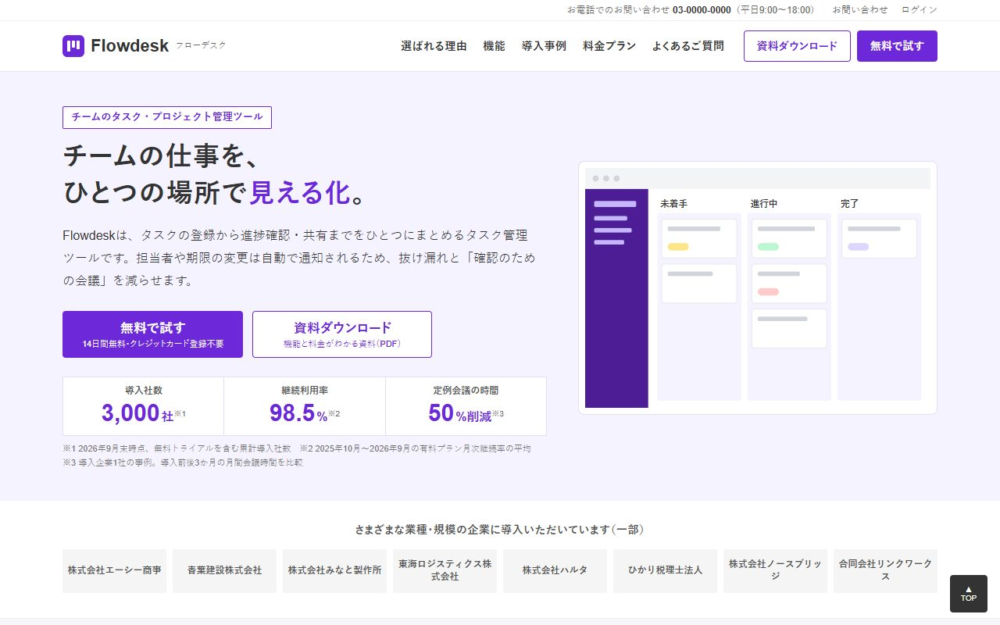
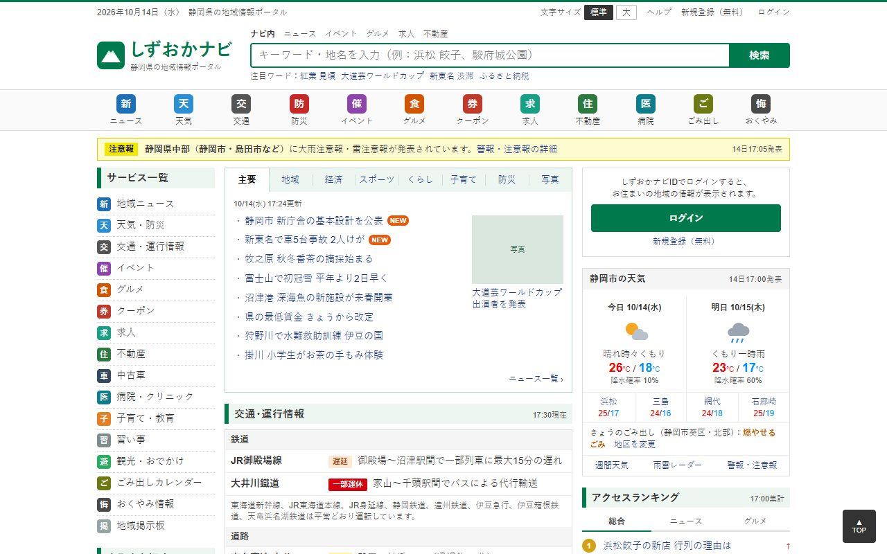
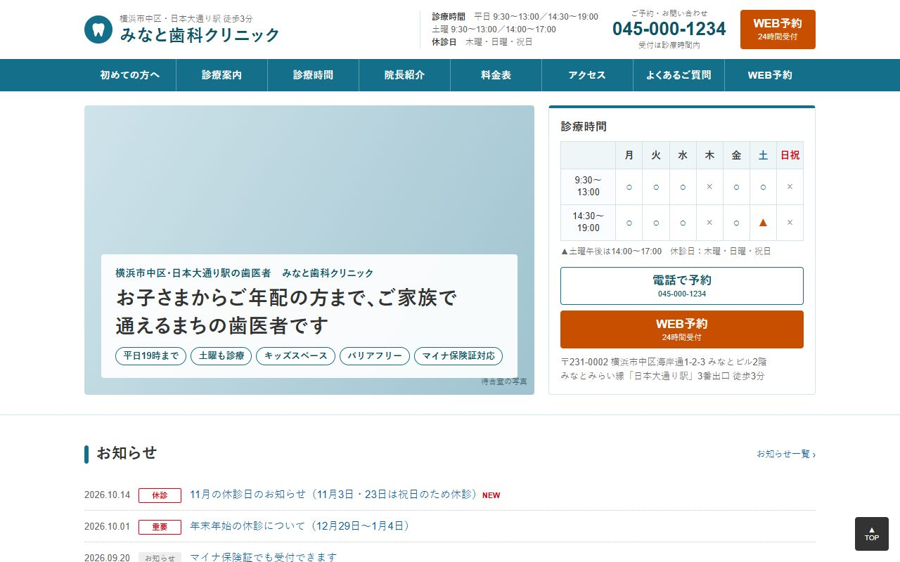
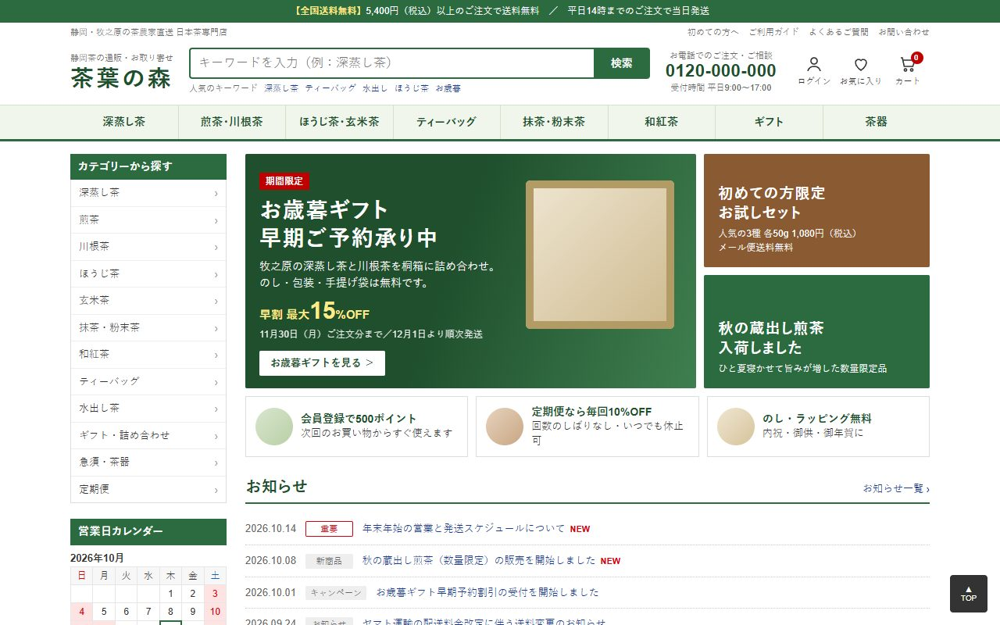
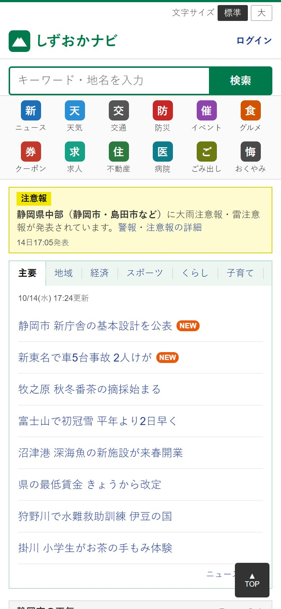
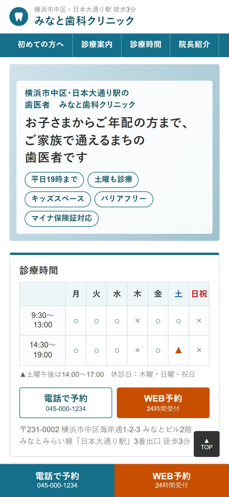

# japanify

**English / 日本語** | [简体中文](README.zh-CN.md)

An agent skill that builds websites and web apps the way Japanese users expect them, or converts an existing site into one. Every rule comes from measuring the 10 most-used Japanese websites, not from guesses about "Japanese style".

日本のユーザーが毎日使っているサイトと同じ感覚のWebサイト・Webアプリを作る（または既存サイトを日本向けに作り替える）ためのエージェントスキルです。ルールはすべて、日本で最も使われているWebサイト上位10件を実測して得た数値にもとづいています。「和風っぽさ」の想像ではありません。

| Before: a typical Western SaaS page / 変換前 | After: japanify / 変換後 |
|---|---|
|  |  |

<sub>Flowdesk is a fictional product used for testing. / Flowdesk はテスト用の架空のサービスです。</sub>

---

## Why / なぜ必要か

AI agents asked for a "Japanese website" tend to produce one of two things: a Western landing page translated into Japanese, or a tourist-poster version of Japan with cherry blossoms and brush fonts. Neither looks like the sites Japanese people actually use. Real Japanese sites have small, solid type, dense link-rich layouts, dark grey text, headings marked with bars, prices with 税込, forms with フリガナ and postal-code address fill, and a footer full of company and legal links.

AIエージェントに「日本向けのサイト」を頼むと、多くの場合「英語のLPをそのまま翻訳したもの」か「桜や筆文字を使った観光ポスター風のもの」が出てきます。どちらも、日本人が普段使っているサイトとは違います。実際の日本のサイトは、小さめでベタ組みの文字、情報量の多いレイアウト、黒ではなく濃いグレーの本文、バーや罫線で区切られた見出し、税込表示の価格、フリガナと郵便番号からの住所自動入力があるフォーム、会社情報と法令表記が並ぶフッターでできています。

japanify gives the agent those conventions as concrete numbers, page recipes, component CSS, form code, a linter and a measuring tool.

japanify は、これらの慣習を具体的な数値・ページ構成・コンポーネントCSS・フォームのコード・チェックツール・計測ツールとしてエージェントに渡します。

## Examples / 作例

Pages built by agents using only this skill. All companies, people and numbers are fictional.

このスキルだけを使ってエージェントが作ったページです。社名・人物・数値はすべて架空です。

| Regional portal / 地域ポータル | Dental clinic / 歯科クリニック |
|---|---|
|  |  |
| **Tea shop / 日本茶の通販** | **Mobile / スマートフォン** |
|  |   |

## What it covers / 対応範囲

| Area / 分野 | Contents / 内容 |
|---|---|
| Typography / タイポグラフィ | OS font stacks, three type modes (dense UI, landing page, reading), `palt`, line breaking, vertical text, ruby / OSフォントのスタック、3つの文字組みモード（情報密度の高いUI・LP・読み物）、palt、改行ルール、縦書き、ルビ |
| Layout / レイアウト | 7 archetypes (portal, EC, article, data, corporate and B2B LP, local business, community) with widths, density targets, section order and mobile headers / ポータル、EC、記事、データ系、企業・BtoB LP、店舗・クリニック、コミュニティの7類型と、幅・密度・セクション順・スマホのヘッダー |
| Components / コンポーネント | お知らせ, headline lists, tabs, ranking, badges, price block, buttons, info tables, 診療時間, reservation calendar, STEP, FAQ, footer / お知らせ、ニュース一覧、タブ、ランキング、バッジ、価格表示、ボタン、情報テーブル、診療時間表、予約カレンダー、STEP、Q&A、フッター |
| Forms / フォーム | What to ask for each purpose, 姓・名, フリガナ, 郵便番号 auto-fill, 都道府県, 全角・半角 normalization, IME-safe Enter, 必須・任意, confirm screen, reservations / 目的別の項目、姓名、フリガナ、郵便番号からの住所入力、都道府県、全角半角の正規化、IME確定時のEnter対策、必須・任意、確認画面、予約フォーム |
| Copy and locale / 文言・ロケール | です・ます vs noun endings, CTA vocabulary, headline length, 「」【】※, dates, 和暦, 税込 prices, 軽減税率, 万・億, page titles / 文体、CTAの言葉選び、見出しの文字数、記号、日付、和暦、税込価格、軽減税率、万・億、タイトルの付け方 |
| Trust and legal / 信頼・法令 | 特定商取引法に基づく表記, privacy policy, 外部送信規律, 会社概要, 景品表示法, 医療広告ガイドライン, 薬機法, payments, LINE, JIS X 8341-3 |
| Tools / ツール | `japanify.css` (drop-in tokens), `japanify.js` (helpers), `check.mjs` (lint), `measure.mjs` (rendered measurement) |

## Install / インストール

**Claude Code (plugin)**: run inside Claude Code / Claude Code 内で実行

```text
/plugin marketplace add zghanw/japanify
/plugin install japanify@japanify
```

**Any agent that supports Agent Skills (skills CLI) / Agent Skills対応のエージェント**

```bash
npx skills add zghanw/japanify
```

**Manual / 手動**

Copy `skills/japanify` into your agent's skills folder: `~/.claude/skills/` for Claude Code (or `.claude/skills/` in a project), `~/.agents/skills/` for Codex, Copilot CLI and Gemini CLI.

`skills/japanify` フォルダを、使っているエージェントのスキルフォルダにコピーしてください。Claude Code は `~/.claude/skills/`（プロジェクト単位なら `.claude/skills/`）、Codex・Copilot CLI・Gemini CLI は `~/.agents/skills/` です。

## Usage / 使い方

The skill loads automatically when the task is about Japanese users. Example prompts:

日本向けの作業だと判断されると、スキルは自動で読み込まれます。たとえば次のように頼んでください。

- 「静岡の日本茶の通販サイトのトップページを作って」
- "Japanify this landing page for the Japanese market."
- 「このお問い合わせフォームを日本のユーザー向けに直して」
- "Review our checkout for Japanese users and fix what feels foreign."
- 「歯科クリニックのサイトを作って。診療時間表とWEB予約も」

### Tools / ツール

```bash
node skills/japanify/scripts/check.mjs src/
```

`check.mjs` needs no dependencies. It reads only the visible text for copy rules, so comments and class names never cause false alarms. Errors: missing `lang="ja"`, Enter handlers without an IME guard, invented autocomplete values. Warnings: name order, missing フリガナ, postal code without auto-fill, prices with no 税込 wording, no 特商法 link on paid offerings, headings above 40px, inputs below 16px, thin Windows fonts, prefectures out of JIS order, and more.

`check.mjs` は依存関係なしで動きます。文言のルールは画面に表示されるテキストだけを対象にするため、コメントやクラス名で誤検知しません。`lang="ja"` の欠落やIME未対応のEnter処理をエラーとして、姓名の順序、フリガナの欠落、住所自動入力のない郵便番号、税込表記のない価格、有料サービスの特商法リンクなし、40pxを超える見出し、16px未満の入力欄、Windowsで細くなるフォント、JIS順でない都道府県などを警告として報告します。

```bash
node skills/japanify/scripts/measure.mjs page.html lp --shots out/
```

`measure.mjs` renders the page at desktop 1280px and iPhone 390px with Playwright and compares text size, line-height, letter-spacing and links above the fold with the measured range of the archetype (`portal`, `ec`, `article`, `data`, `lp`, `local`, `community`).

`measure.mjs` は Playwright でPC（1280px）と iPhone（390px）の表示を再現し、文字サイズ・行間・字間・ファーストビューのリンク数を、選んだ類型の実測範囲と比べます。

## The benchmark / ベンチマーク

Japan-origin, general-audience sites ranked by the mean of the Semrush and Similarweb Japan ranks (September 2026), measured on 2026-10-14 with headless Chromium at 1280px and on an iPhone viewport.

日本発・一般向けのサイトを、Semrush と Similarweb の日本国内順位（2026年9月）の平均で順位付けし、2026年10月14日にヘッドレスChromium（PC 1280px と iPhone 幅）で実測しました。

| # | Site / サイト | Median text / 本文の中央値 | Line-height / 行間 | Notes / 特徴 |
|---|---|---|---|---|
| 1 | Yahoo! JAPAN | 14px | 1.4 | Fixed 990px, 85 links above the fold / 固定幅、ファーストビューに85リンク |
| 2 | 楽天市場 | 12 to 13px | 1.3 to 1.5 | One accent red #bf0000 for price and CTA / 価格とボタンに赤1色 |
| 3 | pixiv | 14px | 1.4 to 1.6 | Fixed 1,016px, pill buttons, flat cards / 固定幅、ピル型ボタン |
| 4 | note | 16px (article 18px) | 1.5 (article 2.0) | 620px reading column, palt on headings only / 620pxの本文カラム |
| 5 | docomo | 14px | 1.3 to 1.5 | One structural brand red, 重要なお知らせ first / ブランド赤の構造的な使い方 |
| 6 | tenki.jp | 14px | 1.4 | 1,048px fixed, bar headings, red max / blue min / 最高気温は赤、最低気温は青 |
| 7 | ウェザーニュース | 13px | 1.5 | Arial-first digits, one radius and one shadow / 数字はArial |
| 8 | Ameba | 12 to 16px | 1.4 to 1.6 | Green pill CTAs, blog sidebar order / 緑のピル型ボタン |
| 9 | livedoor | 13 to 14px | 1.2 to 1.5 | 15-character headlines, 110 links above the fold / 15文字の見出し |
| 10 | TRILL | 14px (article 16px) | 1.5 (article 1.8) | Grayscale chrome, photos carry the color / 写真以外はグレー |
| + | 食べログ | 12 to 13px | 1.4 | Scores, reviews, reservation calendar / 点数・口コミ・予約カレンダー |

Full numbers: [`skills/japanify/references/benchmarks.md`](skills/japanify/references/benchmarks.md) / 詳細な数値は benchmarks.md を参照してください。

## How it was tested / 検証方法

The same brief (a Japanese green-tea shop top page) was given to an agent without the skill and to an agent with it, and both results were measured with `measure.mjs` next to the real 楽天市場 top page. Two independent QA agents then built four pages with the skill (tea shop, dental clinic, SaaS conversion, regional portal) and reported every problem they found; those findings were fixed before release.

同じ依頼（日本茶の通販サイトのトップページ）を、スキルなしのエージェントとスキルありのエージェントに出し、どちらも `measure.mjs` で実際の楽天市場トップと比べました。さらに2体のQAエージェントがスキルを使って4ページ（日本茶の通販、歯科クリニック、SaaSの日本向け変換、地域ポータル）を作り、見つけた問題をすべて報告しました。公開前にそれらを修正しています。

| Measured / 計測値 | Without skill / スキルなし | With japanify / スキルあり | 楽天市場 (real) |
|---|---|---|---|
| Median text size / 本文サイズの中央値 | 13px | 12px | 12px |
| Median line-height / 行間の中央値 | 1.8 | 1.5 | 1.3 |
| Text with letter-spacing / 字間を空けたテキスト | 97% | 9% | 0% |
| Japanese web font / 日本語Webフォント | Noto Sans JP | none / なし | none / なし |
| Links above the fold / ファーストビューのリンク数 | 23 | 46 | 29 |

The regional portal built with the skill measured 13px, 94% of text at 14px or less, line-height 1.4 and 77 links above the fold, next to Yahoo! JAPAN at 14px, 100%, 1.4 and 85.

スキルで作った地域ポータルは、本文13px、14px以下のテキスト94%、行間1.4、ファーストビューのリンク77件でした。Yahoo! JAPAN は14px、100%、1.4、85件です。

## Repository layout / 構成

```
skills/japanify/
  SKILL.md                         entry point / エントリーポイント
  references/
    benchmarks.md                  measured top 10 / 実測データ
    typography.md
    layout-and-components.md
    forms.md
    copy-and-locale.md
    trust-and-legal.md
  assets/
    japanify.css                   drop-in tokens and components
    japanify.js                    helpers (IME, postal code, dates, yen)
  scripts/
    check.mjs                      Japan-readiness lint, no dependencies
    measure.mjs                    rendered measurement (Playwright)
docs/images/                       README screenshots
.claude-plugin/                    Claude Code plugin manifest
```

## License / ライセンス

MIT
